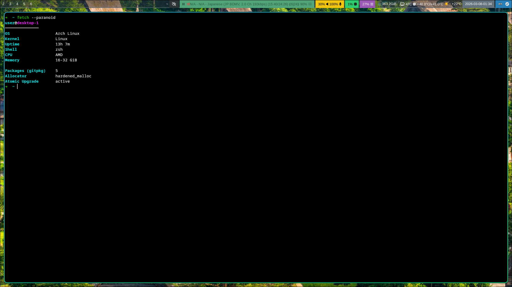

# Dotfiles



Arch Linux dotfiles, managed with [dotm](https://github.com/fkzys/dotm): a Hyprland (uwsm) desktop — waybar, kitty/zsh, neovim/lazygit, lf/thunar, mpd/ncmpcpp/mpv, Firefox and ungoogled-chromium, OpenCloud, sing-box, and a keys-vault-encrypted `~/keys` — with bubblewrap-sandboxed GUI and CLI apps.

## Docs

- **[hardening](docs/hardening.md)** — memory-allocator hardening and application sandboxing.
- **[lf](docs/lf.md)** — lf previews and watch tracking.
- **[notes](docs/notes.md)** — per-host config, services, scripts, secrets.
- **[tests](tests/README.md)** — the git-rtz and secret-history test suites.

## Setup on a new machine

1. Create age key:
```bash
mkdir -p ~/keys/age
age-keygen -o ~/keys/age/dotm-pq.txt
```

2. Initialize the vault:
```bash
keys-vault init
keys-vault open
```

3. Add public key to `.sops.yaml` and re-encrypt secrets:
```bash
# Edit .sops.yaml, add new recipient
sops updatekeys secrets.enc.yaml
```

4. Add host data to secrets:
```bash
sops secrets.enc.yaml
# Add entries under the relevant application keys
```

## Install

```bash
git clone https://github.com/fkzys/dotfiles.git
cd dotfiles
dotm init
dotm apply
```

During init, dotm will prompt for feature flags (nvidia, laptop, etc.).

### Package management

All packages (pacman, AUR, flatpak, gitpkg, pnpm) are managed by dotm via `dotm.toml`. A bootstrap script (`scripts/bootstrap.sh.tmpl`) installs the prerequisite tools (aurutils, gitpkg) on new machines before calling `dotm apply`.

## Credits

Some configs based on [tatsumoto-ren/dotfiles](https://github.com/tatsumoto-ren/dotfiles):
- `.local/bin/cabl`
- `.local/bin/dmenu`
- mpd, ncmpcpp, lf, fontconfig, mpv/input.conf

## License

AGPL-3.0-or-later
